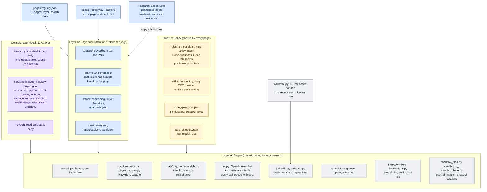
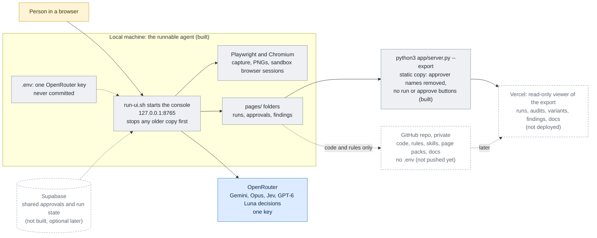

# Sarvam website agent: architecture

v8, 15 Nov 2026, PROPOSED (as built after Decisions Log row 40). Written for: the project owner and any reviewer. One document. Open `architecture.html` for the styled version.

## At a glance

- **What it does.** One run audits the hero of a Sarvam page for one buyer and one goal. It writes better heroes only if the audit finds a gap. A person approves from side-by-side PNGs. A sandbox then tests the approved hero against the baseline.
- **Scope.** The hero only: H1, sub-line and main button. Desktop. Thirteen pages are listed; Voice Agents, Token Factory and Coding Agents have been run.
- **Models.** Four makers on one OpenRouter key: Google's Gemini 3.8 Flash reasons, Anthropic's Opus 5.5 writes, and Jev and OpenAI's decision model judge. Code verifies every fact any model writes.
- **Evidence.** Every claim in a variant maps to a quote found word for word on the saved page. The console ticks each assignment line from the run's own files.

**Status.**

- **Built and tested.** Page setup and approvals, capture, audit, dossier, writer, Gate 1, Gate 2 with two judges, shortlist, human approval, dynamic sandbox, findings, console, read-only export, README, Jev note.
- **Partly built.** Step 5 test plan: goal, link, thresholds and rules are saved with the run, but no separate hashed plan file. The Revise button asks for a new run; its note does not reach the writer yet.
- **Not built.** Mobile view. A repeated Test 1. Hand-editing a variant before approval. A hashed plan file. COVERAGE.md as a file (the console shows the tick list). Supabase. Deploy to Vercel. Push to GitHub.

## 1. The run: audit first, write only if there is a gap

Colours: Person, Rules (code), Reasoning LLM (Gemini), Writer LLM (Opus), Jev, Judge 2. Red boxes stop the run.

```mermaid
flowchart TD
    classDef person fill:#FFF4D6,stroke:#C9A227,color:#3b2f00
    classDef rules fill:#EEF0F3,stroke:#8A94A3,color:#1f2933
    classDef writer fill:#DCEBFF,stroke:#3B82C4,color:#0b2a4a
    classDef reasoning fill:#FFE8D9,stroke:#D9733B,color:#4a1f05
    classDef jev fill:#EADFFF,stroke:#7A4DD8,color:#2a1260
    classDef stop fill:#FDE2E2,stroke:#D14B4B,color:#5a1010
    classDef gate fill:#EEF0F3,stroke:#4a5568,stroke-width:3px,color:#1f2933
    classDef gate2 fill:#EADFFF,stroke:#7A4DD8,stroke-width:3px,color:#2a1260
    classDef gate3 fill:#FFF4D6,stroke:#C9A227,stroke-width:3px,color:#3b2f00

    S1["1 Start (person), in the console<br/>page, industry, buyer persona, goal<br/>the goal list changes with the buyer<br/>pick and click: no context to type"]:::person
    SU{"Page set up?"}:::rules
    SD["Page setup, once per page<br/>needs positioning and claims approved; the buyer checklist is optional<br/>Gemini drafts claims: every quote checked word for word<br/>then a 12-section positioning pack: structure checked by code<br/>and a buyer checklist from the persona research"]:::reasoning
    SP["Person clicks Approve on each part<br/>approvals.json keeps a hash of each file<br/>an edited file needs a fresh approval"]:::person
    S2["2 Capture the hero once with Playwright<br/>H1, sub-line, main CTA, desktop screenshot<br/>the rest of the page is stored, never audited<br/>the live site is not called again<br/>mobile view: not built"]:::rules
    S4["3 AUDIT the hero: JEV only<br/>A1 audience, A2 value, A3 proof, A4 button, A5 positioning<br/>A6 rival swap, only if rival heroes are saved<br/>A7 buyer questions and A8 main objection, if the checklist is approved<br/>pass and fail lines come from calibration<br/>a gap = a required question A1 to A4 fails or holds"]:::jev
    D{"Gap found?"}:::rules
    N["Stop: report no gap<br/>nothing is written"]:::stop
    S5["4 GAP DOSSIER<br/>Gemini writes it, code checks every number, id and quote<br/>what the hero says now, which buyer question fails and why<br/>hypothesis, what we do not know (no internal analytics)<br/>what would prove it wrong"]:::reasoning
    S6["5 TEST PLAN: partly built<br/>the goal and its real link, the thresholds and the rules are saved with the run<br/>a separate hashed plan file is not written yet"]:::rules
    S7["6 WRITER: Opus 5.5 drafts 3 variants<br/>one angle each, a claim map for every sentence<br/>told the gaps, the buyer's objection and the positioning promise<br/>told which buyer questions the live hero already answers: keep them"]:::writer
    G1["Gate 1: RULES<br/>claim id and quote, banned words, no new number<br/>the button goes to a real link for the goal<br/>only the hero changes"]:::gate
    R{"Rounds left?<br/>max 2"}:::rules
    X["Stop: show the failures to the person"]:::stop
    G2["Gate 2: JEV + JUDGE 2 (GPT-6 Luna decisions)<br/>supports the claim, overreach, better than the live hero<br/>better = gain of 0.10 or more on the gaps, no other question down over 0.05<br/>both scores are recorded for every question<br/>no loop after Gate 2"]:::gate2
    SL["Shortlist: nothing is hidden<br/>passed, held (judges disagree or a banned flag code cannot confirm)<br/>failed Gate 2, marked NEAR MISS if only a held-out question fell<br/>failed Gate 1 is counted, not selectable"]:::rules
    S9["7 Apply the words to the saved page<br/>text swap only, layout and styles unchanged<br/>hero PNG pair: live and variant<br/>check that the button goes to the real link"]:::rules
    AP["8 HUMAN approval, in the console<br/>PNGs side by side, word diff, both judges' scores per question, the dossier<br/>a person may pick any variant that passed Gate 1, even a Gate 2 failure, with a typed reason<br/>approval.json is append-only, with hashes of the variant and the PNG"]:::gate3
    RJ["Reject: the variant stays inactive<br/>no exposure"]:::stop
    S11["9 SANDBOX PLAN, built for each run<br/>visitor groups: the buyer plus the other roles of the industry<br/>reaction strength: how well the goal fits each role<br/>lift: 0.5 x the judges' average gain, floor 2%, cap 50%<br/>visitors per arm: the sample a real test needs<br/>Gemini explains it, code checks its numbers"]:::reasoning
    S12["10 SIMULATE and CLICK: no model<br/>Test 1 expected lift, big sample. Test 2 same lift, too few visitors. Test 3 page against itself<br/>20 scripted Playwright sessions per arm on a local copy<br/>every outside request is blocked"]:::rules
    FD["11 FINDINGS, built from the data<br/>plain words, the set-up, rates with intervals<br/>the sample a real test needs, limits<br/>all SYNTHETIC. Status: NOT rolled out, rollout needs approval"]:::rules
    DOC["12 Submission and docs, in the console<br/>README, architecture, Jev note, tick list for the run"]:::rules
    S1 --> SU
    SU -- no --> SD --> SP --> S2
    SU -- yes --> S2
    S2 --> S4 --> D
    D -- no --> N
    D -- yes --> S5 --> S6 --> S7 --> G1
    G1 -- fail --> R
    R -- yes --> S7
    R -- no --> X
    G1 -- pass --> G2
    G2 -- pass --> SL
    G2 -- fail --> SL
    SL --> S9 --> AP
    AP -- reject --> RJ
    AP -- "revise: start a new run" --> S7
    AP -- approve --> S11 --> S12 --> FD --> DOC
```

The writer never sees judge probabilities, pass lines or calibration cases. The judges never see the writer's reasoning or each other's answers. Step by step detail: who does it, what it reads, what it makes.

| # | Step | Who | Model | Reads | Makes |
|---|---|---|---|---|---|
| 1 | Start | Person | No model | The choices in the page folder: buyers, goals, test types | brief.json |
| 2 | Capture the hero | Rules (code) | No model. Playwright. | The live page, or a saved snapshot | hero.json, hero-desktop.png |
| 3 | Positioning | Reasoning LLM (Gemini), Rules (code), Person | Reasoning LLM (Gemini) only if no positioning is saved; a person approves | Claims with evidence, do-not-claim list, buyer checklist, captured text, the positioning skill | positioning.md |
| 4 | Audit the hero | Jev | Jev | Hero text, one checklist item, the positioning main claim, rival rows | audit.json |
| 5 | Gap dossier | Reasoning LLM (Gemini), Rules (code) | Reasoning LLM (Gemini) writes the prose. Rules check every number against audit.json. | Audit questions and probabilities, hero text, checklist, evidence ids | GAP-SYNTHESIS.md |
| 6 | Lock the test plan | Rules (code) | No model | Brief and dossier | test-plan.json and its hash |
| 7 | Write variants | Writer LLM (Opus) | Writer LLM (Opus 5.5) | Dossier, claims with evidence, do-not-claim list, one checklist item, the copy and CRO skills, the name of a failed rule on a retry | variants.json with a claim map |
| 8 | Check the variants | Rules (code), Jev, Judge 2 | Gate 1: rules. Gate 2: Jev and Judge 2. | Variant line, one claim and its evidence quote, do-not-claim list, rival rows, baseline hero | gate1.json, gate2.json |
| 9 | Preview and flow check | Rules (code) | No model | Passing variants and the captured page | PNG pairs, word diff, flow-check.json |
| 10 | Human approval | Person | No model | PNG pairs, word diff, dossier, locked plan | approval.json with a hash |
| 11 | Sandbox | Rules (code), Reasoning LLM (Gemini) | Built per run: visitor groups from the buyer's industry, reaction strength from how well the goal fits each role, lift from the judges' average gain by a fixed rule, visitor counts from the sample a real test needs. The reasoning model explains the set-up; code checks every number. Playwright bots check the pages. | Approved variant, buyer, goal, judge scores, saved page | sandbox-results.json, events.jsonl, FINDINGS.md |
| 12 | Findings and submission | Reasoning LLM (Gemini), Rules (code) | Reasoning LLM (Gemini) drafts the explanatory prose. Code builds every number, table, the tick list and the limits statement. Rules verify the prose. | Every file above: audit, variants, gates, approval, events, run log | FINDINGS.md, COVERAGE.md, README.md, ARCHITECTURE.md, JEV-NOTE.md |

## 2. The three layers

A new page is a new folder in layer C. Layer A holds no page names. Layer B is shared by every page, so one rule change reaches all pages.

## 3. Deployment: local, GitHub, Vercel

| What | Where it works | Why |
|---|---|---|
| Capture with Playwright and Chromium | Local machine | Vercel functions cannot run a full browser. |
| Model calls (Gemini, Opus, Jev, Judge 2) | Local machine | The key lives in `.env` or the environment. It is never in the repo or the export. |
| Page setup, approvals, Start a run, Run the sandbox | Local console | A person clicks. The console accepts only requests from its own page. |
| Reading runs, audits, variants, scores, findings, docs | Local console or the Vercel read-only copy | The copy is static files. Approver names become "a person". |
| Live runs for other people | Their own machine, using the README | A hosted version would need a container host for the browser and a key per user. Not built. |

Only the read-only copy can go on Vercel. Nothing is pushed or deployed yet. Keep the GitHub repo private: it holds buyer research. Vercel and GitHub both need the owner's explicit go-ahead.

## 4. What it uses

### Models

| Role | Model id | Endpoint | Returns | Used in |
|---|---|---|---|---|
| Reasoning LLM | google/gemini-3.8-flash | OpenRouter chat completions | Text: page-setup research and claim drafts, positioning draft, dossier prose, submission prose. Never decides pass or fail. | Page setup, steps 3, 5, 12 |
| Writer LLM | anthropic/claude-opus-5.5 | OpenRouter chat completions | Text: hero variants (H1, sub-line, button) and their claim map | Step 7 |
| Jev (Judge 1) | typesafe/jev-1.14 | OpenRouter Decisions API | Probabilities only. No text. | Steps 4, 8, calibration |
| Judge 2 | openai/gpt-6-luna-decisions | OpenRouter Decisions API | Probabilities only. No text. | Step 8, calibration |

- **Four makers, one key.** Google's Gemini reasons, Anthropic's Opus writes, TypeSafe's Jev and OpenAI's decision model judge. No judge grades its own maker's writing.
- **Models never decide a fact.** Code checks every quote, number, id and banned phrase. A person approves. Judges return probabilities, not reasons.
- **Cost.** A run costs about $0.25 to $0.50. A sandbox costs a cent or two. The reasoning model drafts page setup for about $0.05 to $0.10.
- **Swap a model** in `agent/models.json`, or with `MODEL_REASONING`, `MODEL_WRITER`, `MODEL_JUDGE1`, `MODEL_JUDGE2`. The decisions endpoint accepts only Jev and the OpenAI decision model today.

### Tools

| Tool | Used for |
|---|---|
| Python 3.9 or newer, standard library | The console server, rules, statistics, the run. No framework. |
| Playwright with Chromium | Capture of the hero, the PNG pairs, and the 20 scripted sessions per arm in the sandbox. |
| OpenRouter | One key for chat models and for the decisions endpoint. Every call is logged with its cost. A cap of $1.00 per process stops overspend. |
| Mermaid (in the browser) | Draws the diagrams in this document only. It is not used at runtime. |
| Semrush (one-off read) | Search visits for the page list. A column only: about 96% of sarvam.ai search visits in India go to free translation tools. |
| Claude Code | Built the project. It is not part of the running agent. |

### Rules and settings

| File | Holds |
|---|---|
| rules/do-not-claim.md | Banned and unproven claims. Gate 1 and the judges both use it. |
| rules/hero-policy.json | Stretch phrases, keep rules, per-page qualifiers (a price must keep the word 'from'). |
| rules/goals.json | Five goals, the real link kind behind each, the goal wording and suggested goal for each buyer role. |
| rules/judge-questions.json | Every audit and Gate 2 question, and the better-than-baseline rule (gain 0.10, drop 0.05). |
| rules/judge-thresholds.json | Pass and fail lines per question, set by calibration against 60 cases. |
| rules/positioning-structure.json | The 12 sections every positioning pack must follow, with the label rules. |
| agent/sandbox_hero.json | The typed assumptions of the sandbox: base click rate, lift rule, goal-fit values, caps. |

### Skills and data

Skills are Markdown files the models read before they write (`skills/`, mapped to steps in `skills/step-skills.json`): seven-page positioning, product marketing, copywriting, copy editing, CRO, plain writing, no-AI-slop, claim-evidence check, Jev decision test, message house, buyer words, test design, sandbox A/B report.

| File | Holds |
|---|---|
| library/personas.json | 8 industries and 60 buyer roles, with what each cares about and what blocks them. Analyst research, not interviews. |
| pages/registry.json | 13 pages from the sarvam.ai navigation and the market map, each with its layer and search visits. |
| pages/<page>/ | The saved hero, claims with evidence, setup approvals and every run. |

## 5. Where Jev fits (assignment question)

| Yes/no decision | Who decides | Why |
|---|---|---|
| D1 Does the hero fail a required buyer question? | Jev (audit) | A fuzzy yes/no on meaning, so a decision model. Rules cannot read meaning. |
| D2 Does this evidence say what the line says? | Rules first (id and quote exist), then Jev and Judge 2 | Rules check what is exact. The decision models check the meaning. Tested on 12 cases, 7 of them failure cases. |
| D3 Is the variant better than the baseline on the gap question? | Jev and Judge 2, same question asked of both heroes | Comparing two probabilities needs no text. A person still approves. |

Rules decide what is exact: ids, quotes, banned words, scope, statistics. The writer writes. The decision models answer fuzzy yes/no questions. A person approves. Full note: `submission/JEV-NOTE.md`.

## 6. What the assignment asks for, and where it sits

| Assignment line | Step | Proof file |
|---|---|---|
| Choose an audience and an intended action | 1 | probe3.json: persona and goal |
| Identify a gap in value, proof, CTA or structure | 3, 4 | probe3.json: audit, GAP-DOSSIER.md |
| Explain the evidence and the hypothesis. No internal analytics. | 4 | GAP-DOSSIER.md |
| Recreate the section locally. Provide a baseline. | 2 | capture/hero.json, hero-desktop.png, snapshot-local.html |
| Create a variant. Preserve supported claims. | 6 | probe3.json: variants, claim map, gate1_rounds, gate2 |
| Reviewable preview or diff | 7, 8 | pair-A.png, pair-B.png, pair-C.png |
| Functional check of the user flow | 7, 10 | events.jsonl (20 sessions per arm) |
| Pause before activating. Reject stays inactive. Revision needs fresh approval. | 8 | approval.json with variant and PNG hashes |
| Define the action, metric and decision rule upfront | 5 (partly) | probe3.json: goal, thresholds_used; sandbox-results.json: plan |
| Sandbox A/B with stable assignment and recorded exposures and conversions | 9, 10 | sandbox-results.json, events.jsonl |
| Conversion rates with uncertainty. A clear and an inconclusive outcome. Synthetic data labelled. | 11 | sandbox/FINDINGS.md |
| Separate simulated findings from real evidence | 11 | sandbox/FINDINGS.md (limits), this document |
| Rollout still requires approval | 11 | Status line in FINDINGS.md |
| One command. A human checkpoint. A model at runtime. Real actions. | 1 to 11 | run-log.jsonl (every model call is logged), README.md |
| Where Jev fits. One decision evaluated with a failure case. What is unverified. | 12 | submission/JEV-NOTE.md, tests/calibration |
| Runnable code, README, setup and demo command | 12 | README.md |
| Architecture note, Jev decision, limitations, real versus simulated | 12 | docs/architecture.md, submission/JEV-NOTE.md |

The console's Submission and docs tab ticks each line for the selected run from its own files. Deleting a file turns its tick off.

## 7. Limits

- The sandbox is synthetic. The lift is set from the judges' scores by a rule, so the simulation cannot show that a variant wins. It shows how many real visitors a real test needs.
- The base click rate (4%) and the goal-fit values are typed assumptions, labelled in every findings file.
- Jev and Judge 2 are general decision models, not trained for this work. Their pass lines come from a small case set we wrote. Scores are an audit signal, not proof.
- Buyer personas and goal suggestions are analyst proposals, not buyer research.
- The hero only, on desktop. No page body, no mobile view.
- A person makes every approval. The agent never writes an approval by itself, except where the owner told it to and the record says so.
