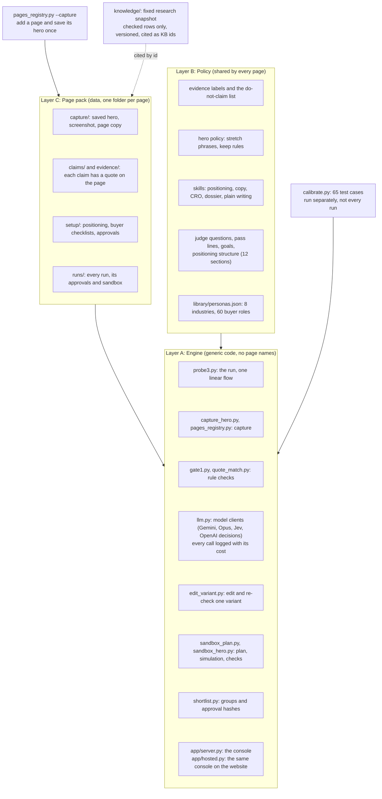
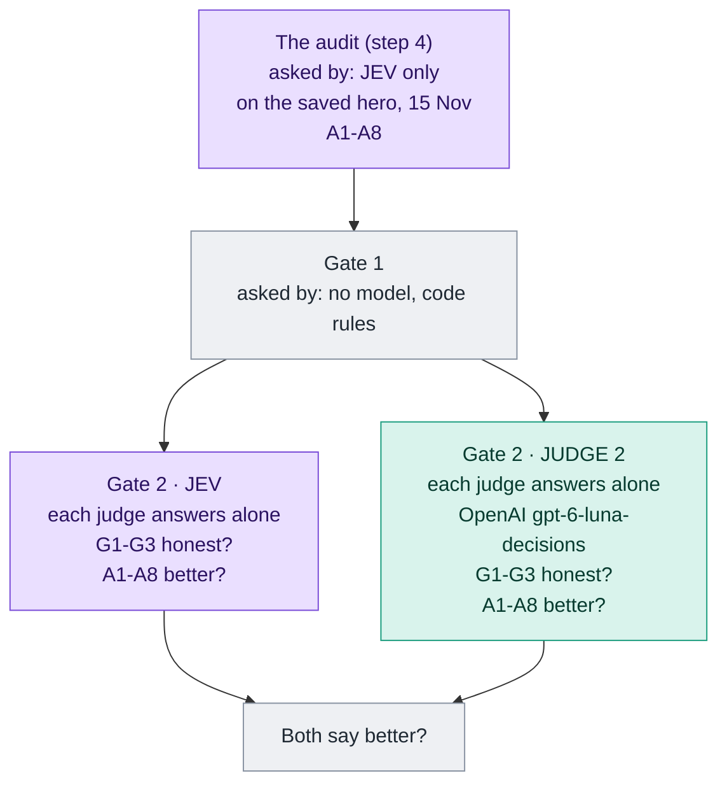
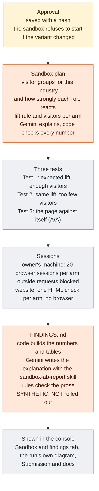
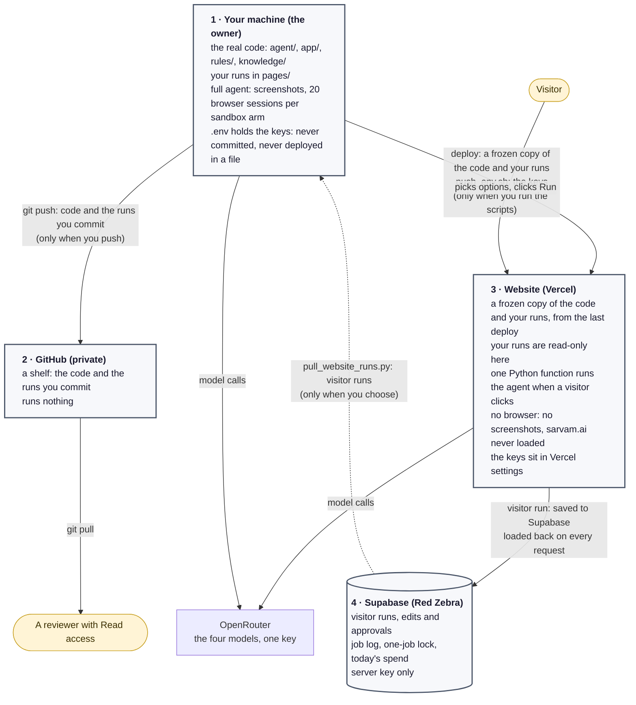

# Sarvam website agent: architecture

v14, 16 Nov 2026, as built. Written for: the project owner and any reviewer. One document.

- **When the pages were read.** Every page's hero was captured once, on 15 Nov 2026. Every run audits that saved copy, so a run gives the same answer even if Sarvam edits its site. To audit a newer version, capture the page again.
- **What it does.** One run audits the hero of a Sarvam page for one buyer and one goal. It writes better heroes only if the audit finds a gap. A person approves one, or edits one and has it checked again. A sandbox then tests the approved hero against the baseline.
- **Where it runs.** On the owner's machine (full agent, with screenshots and browser checks) and on the website, where anyone can start a run. Website runs are saved in Supabase.
- **Scope.** The hero only: H1, sub-line and main button. Desktop. Thirteen pages are listed; Voice Agents, Token Factory and Coding Agents have been run.
- **Models.** Four makers on one OpenRouter key: Google's Gemini 3.8 Flash reasons, Anthropic's Opus 5.5 writes, and Jev (Judge 1) and OpenAI's decision model (Judge 2) judge. Code verifies every fact any model writes.
- **Evidence.** Every claim in a variant maps to a quote found word for word on the saved page. The console ticks each assignment line from the run's own files.

## 1. The run: audit first, write only if there is a gap

```mermaid
flowchart TD
    S["1 Start (person)<br/>page, industry, buyer persona, goal<br/>picked from drop-downs, in the local console or on the website<br/>the goal list changes with the buyer; the first goal is the suggestion"] --> C["2 Capture the page once with Playwright (owner's machine)<br/>done on 15 Nov 2026 for all 13 pages<br/>keep the hero only: H1, sub-line, main CTA text and link<br/>plus a hero screenshot (desktop) and a saved copy of the page<br/>the rest of the page is stored, never audited<br/>every run reads this saved copy, never the live page<br/>to audit a newer version of the page, capture it again"]
    C --> P{"3 Page set up<br/>and approved?"}
    P -- yes --> L["Load the approved positioning, claims and buyer checklist<br/>(the checklist is optional: it adds questions A7 and A8)"]
    P -- no --> G["Reasoning model (Gemini) drafts the page setup<br/>claims: each tied to a quote found word for word on the saved page<br/>positioning: 12 sections, every bullet sourced and labelled<br/>sources: the saved page and knowledge/ only, cited as KB ids<br/>buyer checklist: questions this buyer asks, tagged hero or page"]
    G --> GC["Rules check the draft<br/>every quote is on the page, every KB id exists,<br/>every number is in its row, the 12-section structure holds<br/>3 tries, then the problems are shown"] --> GP["Owner approves each part<br/>(on the website this needs the owner code)<br/>the approval keeps a hash: an edited file needs a fresh approval"]
    GP --> L
    L --> A["4 AUDIT the saved hero (captured 15 Nov): JEV only<br/>A1 the buyer sees their situation, A2 says what they get in plain words,<br/>A3 gives a checkable proof, A4 the button says what happens<br/>(these four can start a rewrite; A5 to A8 inform only)<br/>each answer is a probability, read against lines from 65 test cases"]:::jev
    A --> D{"Gap found?<br/>A1 to A4 fails or holds"}
    D -- no --> N["Stop: report 'no gap'<br/>nothing is written"]
    D -- yes --> H["5 GAP DOSSIER (written out in full)<br/>Gemini writes it; code checks every number, id and quote, 2 fix rounds<br/>what the hero says now, exact text<br/>which buyer question fails and why it matters to this buyer<br/>hypothesis: if we change X for buyer Y, more of them click, because E<br/>what we do not know: no internal analytics<br/>what would prove it wrong"]
    H --> T["6 TEST PLAN<br/>action: one click on the hero's main button<br/>the button must go to the real link for the chosen goal<br/>pass lines, the better-than-baseline rule and the spend cap are saved with the run<br/>(a separate hashed plan file is not built yet)"]
    T --> W["7 WRITER (Opus) drafts 3 hero variants, then edits them<br/>one angle each; every sentence lists the claim id it relies on<br/>told the gaps, the buyer's question, the objection and the positioning promise<br/>told what the live hero already answers: keep it"]
    W --> G1["Gate 1: RULES (no model)<br/>claim id exists and its quote is on the page<br/>no banned phrase, no new number or comparison<br/>no third-party model named<br/>the button goes to the real link for the goal<br/>only the hero changes"]:::gate
    G1 -- fail --> R{"Rounds left?<br/>max 2"}
    R -- yes --> W
    R -- no --> X["Variant marked: failed Gate 1<br/>shown with its problems; it can be edited (step 9)"]
    G1 -- pass --> G2J["Gate 2: JEV<br/>G1-G3 honest? then A1-A8 better?"]:::gate2
    G1 -- pass --> G2K["Gate 2: JUDGE 2<br/>OpenAI gpt-6-luna-decisions<br/>same questions, answers alone"]:::judge2t
    G2J --> BB["Both say better?<br/>better = average gain of 0.10 or more on the gaps,<br/>and no other question down by more than 0.05<br/>disagree = held for a person"]
    G2K --> BB
    BB --> SL["Shortlist: nothing is hidden<br/>passed: both judges say better<br/>held: the judges disagree, or a banned flag that code cannot confirm<br/>failed Gate 2: marked NEAR MISS when only a kept question fell<br/>failed Gate 1: shown, not approvable as it stands"]
    X --> SL
    SL --> PX["8 Picture each variant for the person (PNG pair)<br/>the capture has a picture of today's hero, but none of the new words yet<br/>so the new words are swapped into the hero: text only, layout unchanged<br/>owner's machine: one read-only load of the live page (no clicks) for this,<br/>because the saved copy draws without its styles offline<br/>website: no picture and no live load; the word-by-word change is shown"]
    PX --> F["Functional check<br/>the button of each arm points to the real link for the goal"]
    F --> AP["9 HUMAN approval<br/>the person sees each variant, both judges' scores per question,<br/>the dossier, the claim map and the PNG pair<br/>a variant that failed Gate 2 can be approved with a typed reason"]:::gate
    AP -- edit --> E["Edit and re-check<br/>the person changes the H1, sub-line or button,<br/>or writes a note and the writer (Opus) rewrites that one variant<br/>the new version goes through Gate 1 and Gate 2 again<br/>and comes back as a new variant, for example B-edit1"]
    E --> G1
    AP -- reject --> RJ["Variant stays inactive<br/>no exposure"]
    AP -- approve --> SP["10 SANDBOX PLAN, built for this run<br/>visitor groups: this buyer plus the other roles in the industry<br/>reaction strength: how well the goal fits each role<br/>lift: 0.5 x the judges' average gain, at least 2%, at most 50%<br/>visitors per arm: the sample a real test needs<br/>Gemini explains the set-up; code checks every number"]
    SP --> SB["Simulate and check (no model)<br/>Test 1: the expected lift, enough visitors<br/>Test 2: the same lift, too few visitors<br/>Test 3: the page against itself (A/A)<br/>owner's machine: 20 browser sessions per arm on the saved page, outside requests blocked<br/>website: one HTML check per arm, no browser"]
    SB --> FD["11 FINDINGS, built from the data<br/>plain words first, then the set-up<br/>rates with intervals, the sample a real test needs, the limits<br/>all SYNTHETIC<br/>status line: NOT rolled out, rollout needs approval"]
    FD --> RD["Redraw this run's diagram<br/>code, no model<br/>after every run, edit and sandbox"]:::rules
    RD --> RS["Write the run story<br/>Gemini, run-story skill<br/>code checks every number, question and variant<br/>2 retries, else no story"]:::reasoning
    RS --> DOC["12 Submission and docs, in the console<br/>README, this architecture, the Jev note,<br/>a flow diagram of the run, the tick list for the assignment"]
    classDef person fill:#FFF4D6,stroke:#C9A227,color:#3b2f00
    classDef rules fill:#EEF0F3,stroke:#8A94A3,color:#1f2933
    classDef writer fill:#DCEBFF,stroke:#3B82C4,color:#0b2a4a
    classDef reasoning fill:#FFE8D9,stroke:#D9733B,color:#4a1f05
    classDef jev fill:#EADFFF,stroke:#7A4DD8,color:#2a1260
    classDef stop fill:#FDE2E2,stroke:#D14B4B,color:#5a1010
    classDef gate fill:#EEF0F3,stroke:#4a5568,stroke-width:3px,color:#1f2933
    classDef gate2 fill:#EADFFF,stroke:#7A4DD8,stroke-width:3px,color:#2a1260
    classDef gate3 fill:#FFF4D6,stroke:#C9A227,stroke-width:3px,color:#3b2f00
    classDef judge2 fill:#D9F3EC,stroke:#1E9E80,color:#073b2f
    classDef judge2t fill:#D9F3EC,stroke:#1E9E80,stroke-width:3px,color:#073b2f
```

The writer never sees judge probabilities, pass lines or calibration cases. The judges never see the writer's reasoning or each other's answers.

## 2. The three layers

- **Layer A, Engine:** the code that does the work. It holds no page names, so one engine serves every page.
- **Layer B, Policy:** the rules every page shares. Change a rule once and it applies to all pages.
- **Layer C, Page pack:** the facts about one page, one folder each. A new page is a new folder.

## 3. Who asks which questions, at each check

Three checks ask questions, in this order. Each check has one asker, one input and one job. Only the audit and Gate 2 use models.

**The audit (step 4).** Jev asks A1 to A8 of the saved hero, captured on 15 Nov 2026.

Why: to find what today's hero fails to say. If there is no gap, nothing is written.

Judge 2 does not run here, because one judge is enough to find gaps.

#### The audit questions

| Question | Asks | Can it start a rewrite? |
|---|---|---|
| A1 situation | Would this buyer recognise their own situation or problem in the hero? A job title is not needed, and a label alone is not enough. | Yes |
| A2 value | Does the hero say what the product does and what the buyer gets from it, in plain words, not a slogan? | Yes |
| A3 proof | Does the hero give a checkable proof point, such as a named standard, a number with its source, or a named customer? | Yes |
| A4 button | Does the main button say what happens on click (for example, open the docs, book a demo, see prices), not just a vague word such as 'Go', 'Learn more' or 'Click here'? | Yes |
| A5 positioning | Does the hero say what the positioning's main claim says? | No. It informs the person and the writer. |
| A6 rival swap | Could any rival in the rival rows print this exact hero on its own page without changing it? (Only when rival heroes are saved.) | No. It informs the person and the writer. |
| A7 buyer question | Does the hero answer this question the buyer asks: {item}? (Only once the buyer checklist is approved.) | No. It informs the person and the writer. |
| A8 objection | Does the hero answer this objection the buyer raises: {objection}? | No. It informs the person and the writer. |

**Gate 1.** No model asks anything. Code rules check each variant.

Why: to stop a variant that is not true or not allowed before any judge is paid.

The rules:
- The claim id exists, and its quote is on the saved page word for word.
- No banned phrase, no new number and no new comparison.
- No third-party model is named.
- The button goes to the real link for the goal.
- Only the hero changes.
- A failed variant goes back to the writer with the reason, at most twice.

**Gate 2.** Jev and Judge 2 each answer alone. Neither sees the other's answers.

Why: to show that a variant is honest and better than today's hero.

**Part 1, honest?** Each judge asks three questions of every fragment of the variant:
- **G1 support** (good answer: yes): "Does the evidence quote say what this fragment says, with nothing added?"
- **G2 overreach** (good answer: no): "Does the fragment say more than the claim and evidence: a wider scope such as 'all' or 'never', a missing condition, a new comparison, or a guarantee?"
- **G3 banned** (good answer: no): "Does the hero make any claim on the do-not-claim list, in other words?"

**Part 2, better?** Each judge asks A1 to A8 again of the variant.

Better means an average gain of 0.10 or more on the gap questions, and no other question down by more than 0.05.

Passed means both judges say better. If the judges disagree, the variant is held for a person.

**Edit and re-check:** the same Gate 1 and Gate 2.

Each answer is a probability of yes. We read it against pass and fail lines set from 65 test cases we wrote. 3 of those cases were held back from tuning. A value near a line means hold, and a person decides.

**Question version:** v2 from 16 Nov 2026. Earlier runs used v1, and each run says which.

## 4. After approval: the sandbox and the findings

After a person approves a variant, the sandbox tests it and the findings explain the result. The sandbox refuses to start unless a variant is approved and unchanged since approval.

These tests check the measuring method. They do not prove a variant wins, because the lift is an input.

## 5. Where things live and what moves between them

**What happens when a visitor clicks Run**

1. The visitor opens the website and picks a page, an industry, a buyer and a goal.
2. They click **Start a run**. The website checks the limits first: one job at a time, $1.00 a run, $3.00 a day for the whole site, 3 runs a day per visitor.
3. Vercel runs the same agent code, from the frozen copy, on its own server. Nothing runs on your machine.
4. The agent calls the models through OpenRouter, with your key. The run log records each call and its cost.
5. Every file the run writes is saved to Supabase. The log is saved every 4 seconds, so the Log tab shows each step as it happens.
6. Any visitor can now open that run, edit a variant, approve one and run the sandbox. Each of these is saved to Supabase too.
7. The run stays on the website. It reaches your machine only when you run `scripts/pull_website_runs.py`, and GitHub only when you then commit and push it.

**What happens when you run it on your own machine**

1. You start the console with `./run-ui.sh` and open http://127.0.0.1:8765. Or you run `agent/probe3.py` from the command line.
2. You pick a page, an industry, a buyer and a goal, and click **Start a run**. One job runs at a time, with a $1.00 cap per run.
3. The agent runs on your machine, with the key in your `.env`. It calls the models through OpenRouter, and the run log records each call and its cost.
4. The audit, writer and gates read the saved copy of the page. For the PNG pairs, the browser loads the live page once, read only, with no clicks.
5. Every file is saved in `pages/<page>/runs/probe3-<date>-<time>/` on your machine. Nothing goes to Supabase, the website or GitHub.
6. You approve a variant and run the sandbox. It runs 20 browser sessions per arm on the saved page, with every outside request blocked.
7. The run reaches GitHub only when you commit and push it, and the website only when you deploy. On the website it is read-only.

**What a visitor can't touch**

- **Your machine.** The website has no link to it.
- **GitHub.** The website has no GitHub key, and Git is disconnected from Vercel. A push never changes the website.
- **The code, rules and knowledge.** They are read-only on the website. Only a deploy from your machine changes them.
- **Your runs.** Runs made on your machine are read-only on the website: no edits, approvals or sandbox on them.
- **Page setup** (positioning, claims, buyer checklist). Only someone with the owner code can draft or approve it.
- **A newer page setup.** A setup file saved on the website before the latest deploy never replaces the deployed copy. The newer one wins.
- **The keys.** They live in the Vercel settings and are never sent to the browser.

**Other guards**

- **Spend.** $1.00 cap per run. On the website: $3.00 a day in total and 3 runs a day per visitor. A credit limit on the OpenRouter key is the last line.
- **One job at a time.** The local console and the website each run one job at a time. On the website the lock lives in Supabase, so it holds across servers.
- **Who may do what.** Anyone may start a run, edit or approve a variant, and run the sandbox. Only the owner (owner code) may draft or approve a page's positioning and claims. Runs made on the owner's machine are read-only on the website.
- **No names stored.** An approval on the website records "a person". It never stores a visitor's name.
- **No bot traffic.** The website and the sandbox never load sarvam.ai. On the owner's machine, the PNG step loads the live page once per run or edit, read only, with no clicks.

## 6. Fleet, not swarm

A multi-agent system is either a **swarm** or a **fleet**. In a swarm, agents decide among themselves how to attack an open problem. That suits exploration, when nobody yet knows how to solve the task. In a fleet, each agent has one fixed job, input, output and handoff. That suits work customers will see.

**This agent is a fleet.** One script (`agent/probe3.py`) runs the steps in a fixed order. Each model has one role. Code checks every output, and a person approves.

**The research before it was not a swarm either.** We checked how each input was made:

- **Positioning:** explored by a person with AI assistants (ChatGPT and Claude), then approved by that person. No agents negotiated among themselves.
- **Buyer insights:** one orchestrator gave every worker the same fixed brief, one industry each. Workers never talked to each other or chose their own method. Code then checked every row, and planted wrong rows to prove the check catches them. That is a fleet that runs in parallel.
- **Claims:** every price and quote was checked by code against fixed rules: the source opens, the number is on the page, a quote matches word for word. Inside the agent, `page_setup.py` drops any claim whose quote is not on the saved page, and a person approves the rest.
- So the exploration was done by people and by parallel workers with one brief. What reached the agent is only what code checked and a person approved: rows in `knowledge/` and approved claims.

### How the fleet works

| Member | Reasons with | Gets | Returns | Checked by |
|---|---|---|---|---|
| Orchestrator (`agent/probe3.py`) | No model. It decides the order. | The run's choices | The next step | Not applicable |
| Reasoning model (Gemini) | Its skills | The saved page, knowledge rows | Page setup draft, dossier, sandbox and findings explanations | Code checks every quote, number and id. A person approves the setup. |
| Writer (Opus) | Its skills | Dossier, approved claims | 3 variants, each with a claim map | Gate 1 (code), then Gate 2 |
| Jev and Judge 2 | No skills: the fixed questions only | Hero text, one claim and its quote | A yes/no probability per question | Calibrated pass lines. Both must agree. |
| Rules (code) | No model | Every output above | Pass, fail and the reasons | Self-tests |
| Person | Their own judgement | Everything above | Approve, edit or reject | Saved with a hash |

**Models reason only inside their own step. Code decides pass or fail, and no model decides what runs next.**

### Which skills each step uses

Each step that uses a model loads a fixed set of skills (written guides for the task):

```mermaid
flowchart TB
    S1["Positioning draft<br/>(Gemini)"]:::reasoning --> K1["seven-page-positioning<br/>product-marketing"]
    S2["Dossier<br/>(Gemini)"]:::reasoning --> K2["cro<br/>buyer-profile-validation<br/>claim-evidence-check<br/>marketing-plain-writing"]
    S3["Writer draft<br/>(Opus)"]:::writer --> K3["copywriting-marketingskills<br/>cro<br/>page-copy-draft"]
    S4["Writer edit<br/>(Opus)"]:::writer --> K4["copy-editing<br/>no-ai-slop<br/>marketing-plain-writing"]
    S5["Findings<br/>(Gemini)"]:::reasoning --> K5["sandbox-ab-report<br/>marketing-plain-writing<br/>no-ai-slop"]
    S6["Run story<br/>(Gemini)"]:::reasoning --> K6["run-story<br/>marketing-plain-writing"]
    S7["Jev and Judge 2"]:::jev --> K7["no skills:<br/>fixed questions only"]
    classDef person fill:#FFF4D6,stroke:#C9A227,color:#3b2f00
    classDef rules fill:#EEF0F3,stroke:#8A94A3,color:#1f2933
    classDef writer fill:#DCEBFF,stroke:#3B82C4,color:#0b2a4a
    classDef reasoning fill:#FFE8D9,stroke:#D9733B,color:#4a1f05
    classDef jev fill:#EADFFF,stroke:#7A4DD8,color:#2a1260
    classDef stop fill:#FDE2E2,stroke:#D14B4B,color:#5a1010
    classDef gate fill:#EEF0F3,stroke:#4a5568,stroke-width:3px,color:#1f2933
    classDef gate2 fill:#EADFFF,stroke:#7A4DD8,stroke-width:3px,color:#2a1260
    classDef gate3 fill:#FFF4D6,stroke:#C9A227,stroke-width:3px,color:#3b2f00
    classDef judge2 fill:#D9F3EC,stroke:#1E9E80,color:#073b2f
    classDef judge2t fill:#D9F3EC,stroke:#1E9E80,stroke-width:3px,color:#073b2f
```

- **One fixed map.** The skills for each step sit in one file, `skills/step-skills.json`. No model chooses skills.
- **Saved fingerprints.** Each run saves every skill's name and sha256 fingerprint in `probe3.json`. The fingerprint changes if the skill text changes.
- **Hard rules win.** The hard rules come after the skills in the prompt and override them. They are the claims rules, the banned list and the Gate 1 limits.

`marketing-psychology` is left out of the writer on purpose. It pushes urgency, numbers and comparisons that the claims rules forbid.

### The five practices

| Practice | What it means | In this agent | Gap |
|---|---|---|---|
| Orchestration | Each step runs in the right order, with the right tool or data. | `probe3.py` runs the 12 steps in a fixed order and stops at each gate. | None known. |
| Evals | Outputs are tested before anyone sees them. | Gate 1 (rules) and Gate 2 (two judges) check every variant. Self-tests check the code. | The judges' test set is small (65 cases, 3 held back from tuning) and written by us. No fixed test set is rerun after each code change. |
| Observability | Every step can be traced, so a mistake can be found and fixed. | `run-log.jsonl` records every model call and its cost. A live Log tab, and a flow diagram for each run. | None known. |
| Guardrails | Limits on what the agent can see, spend and change. | Spend caps, the one-job lock, the owner code, the do-not-claim list, knowledge-base number checks. | None known. |
| Model routing | Each task goes to the right model, and a model can be swapped without starting over. | Four roles in `models.json`. Swap one in `.env`. | If a model fails, nothing switches to a backup. |

### LangGraph and LangSmith

We did not use them. The agent is plain Python, and each job those tools do has a part here:

- **The graph of steps (LangGraph's job):** `agent/probe3.py` calls the steps in a fixed order. The gates are the branches: a Gate 1 fail goes back to the writer, at most twice; a pass goes on.
- **Saved state (LangGraph's checkpoints):** each run's `probe3.json` holds the result of every step. An edit, the approval and the sandbox read it and add to it, so a run can be picked up later, by anyone, on the machine or the website.
- **The pause for a person (LangGraph's interrupt):** the run stops before approval. Only a person's click saves an approval, with a hash of what was approved. The sandbox refuses to start without one, or if the variant changed since.
- **Traces (LangSmith's job):** `run-log.jsonl` records every model call: its role, the model asked, the model that answered, the time and the cost. Each run also gets its own flow diagram.
- **Evals (LangSmith's job):** Gate 1 rules, the two judges, the 65 test cases in `calibrate.py` (3 held back from tuning), and the self-tests.
- **Why plain Python.** The flow is fixed, so a framework adds little. The website function needs no extra packages, and every step can be read in one file. If the flow later needs many branches or many parallel workers, LangGraph would be worth adding.

### How each run's view is made

The facts of a run are saved once, in its run file (`probe3.json`). When someone opens the run, plain code with no model draws the diagram from that file (`agent/run_flow.py`) and builds the question list. Steps the run did not reach are grey and dashed. The same run always gives the same view. So when we improve the code, every old run is updated with no new model call. The story is the one part a model writes. It is written once per run, and again after an edit or sandbox. Code checks it and saves it. Old runs show the exact question wording they were asked. It comes from the run file, or from the v1 or v2 archive and the page's buyer checklist, and it is labelled as such. The diagram template and its cases are in `.claude/skills/run-architecture/SKILL.md`.

## 7. Models

- **Reasoning model, Google `gemini-3.8-flash`:** page setup drafts, the dossier, the sandbox explanation. It never decides pass or fail.
- **Writer, Anthropic `claude-opus-5.5`:** the hero variants, the claim map, and a rewrite when a person asks for one.
- **Jev, `typesafe/jev-1.14` (Judge 1):** the audit, Gate 2 and edit re-checks. It returns probabilities, not reasons.
- **Judge 2 (OpenAI `gpt-6-luna-decisions`):** Gate 2 and edit re-checks only; not at the audit. Two judges from different makers; no judge grades its own maker's writing.
- **One OpenRouter key** serves all four. Swap a model in `agent/models.json` or with `MODEL_REASONING`, `MODEL_WRITER`, `MODEL_JUDGE1`, `MODEL_JUDGE2`.
- **Cost.** A run costs about $0.25 to $0.55. An edit about $0.05 to $0.15. A sandbox a cent or two.

## 8. Limits

- The sandbox is synthetic. The lift is set from the judges' scores by a rule, so the simulation cannot show that a variant wins. It shows how many real visitors a real test needs.
- The base click rate (4%) and the goal-fit values are typed assumptions, labelled in every findings file.
- Jev and Judge 2 are general decision models, not trained for this work. Their pass lines come from a small case set we wrote. Scores are an audit signal, not proof.
- Buyer personas and goal suggestions are analyst proposals, not buyer research.
- The hero only, on desktop. No page body, no mobile view.
- A person makes every approval. The agent never writes an approval by itself, except where the owner told it to and the record says so.

## 9. Next (not built)

- **A learning loop, run as a fleet, not a swarm.** (1) Every decision is already recorded: what a person approved, edited or rejected and why, and every gate failure. (2) A person reviews those records and marks each case right or wrong. (3) Reviewed cases join the judges' test set (`calibrate.py`). (4) A rule or a pass line changes only after the old and new cases are rerun, including cases held back from tuning. (5) A person approves the change. No model changes its own rules. Not built.
- **A model backup.** If a model call fails or a model is retired, use a named backup for that role and record which model answered. The judges have no backup today: OpenRouter's decisions endpoint accepts only Jev and OpenAI's decision model. Not built.
- **A fixed test set rerun after every code change**, so a change that makes the judges or the gates worse is caught before a run uses it. Not built.
