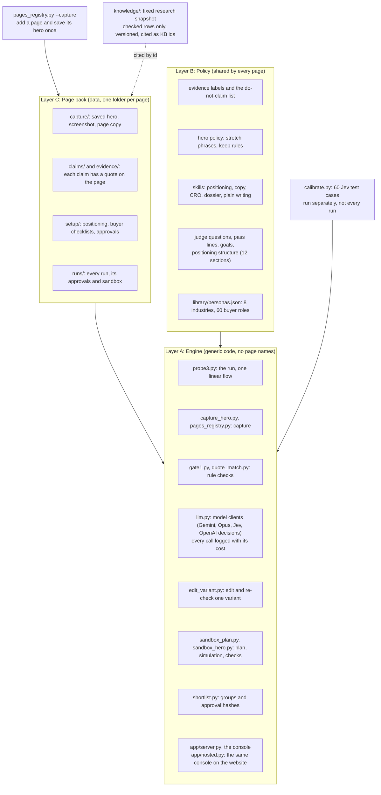
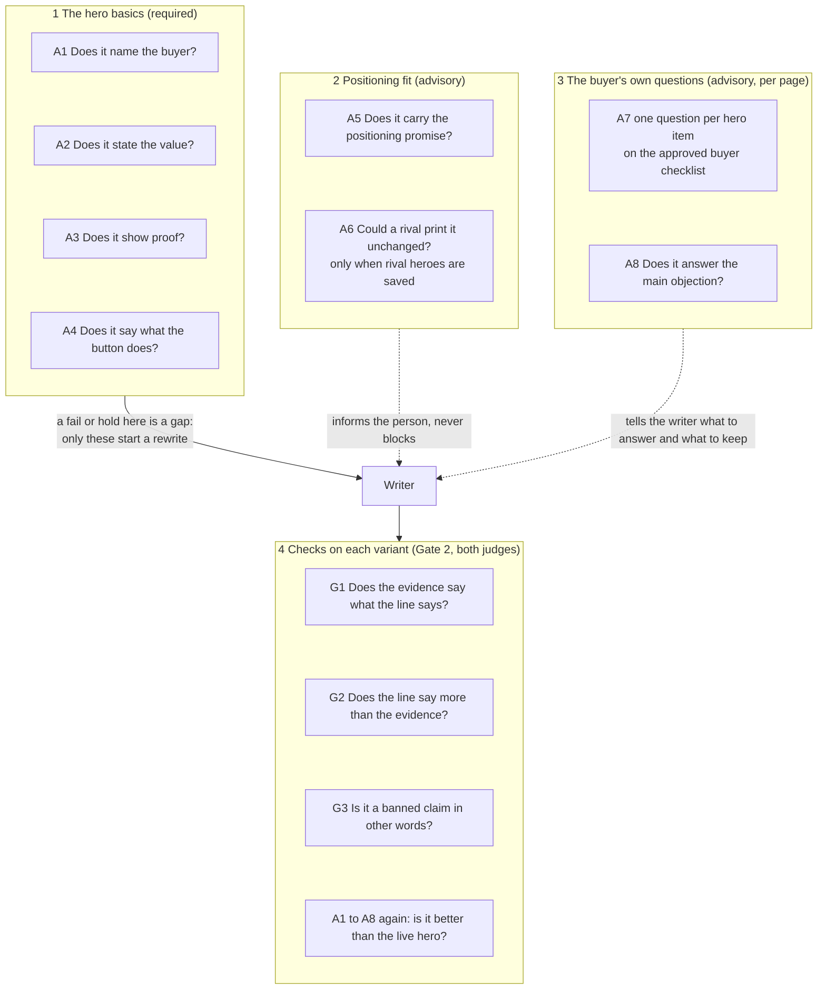
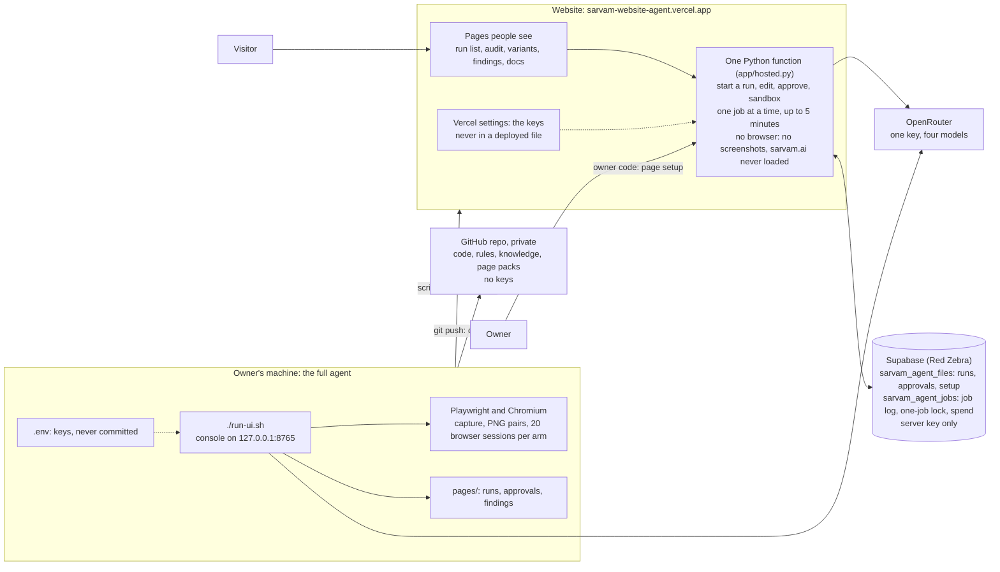

# Sarvam website agent: architecture

v10, 16 Nov 2026, as built. Written for: the project owner and any reviewer. One document.

- **What it does.** One run audits the hero of a Sarvam page for one buyer and one goal. It writes better heroes only if the audit finds a gap. A person approves one, or edits one and has it checked again. A sandbox then tests the approved hero against the baseline.
- **Where it runs.** On the owner's machine (full agent, with screenshots and browser checks) and on the website, where anyone can start a run. Website runs are saved in Supabase.
- **Scope.** The hero only: H1, sub-line and main button. Desktop. Thirteen pages are listed; Voice Agents, Token Factory and Coding Agents have been run.
- **Models.** Four makers on one OpenRouter key: Google's Gemini 3.8 Flash reasons, Anthropic's Opus 5.5 writes, and Jev and OpenAI's decision model judge. Code verifies every fact any model writes.
- **Evidence.** Every claim in a variant maps to a quote found word for word on the saved page. The console ticks each assignment line from the run's own files.

## 1. The run: audit first, write only if there is a gap

```mermaid
flowchart TD
    S["1 Start (person)<br/>page, industry, buyer persona, goal<br/>picked from drop-downs, in the local console or on the website<br/>the goal list changes with the buyer; the first goal is the suggestion"] --> C["2 Capture the page once with Playwright (owner's machine)<br/>keep the hero only: H1, sub-line, main CTA text and link<br/>plus a hero screenshot (desktop) and a saved copy of the page<br/>the rest of the page is stored, never audited<br/>runs never load sarvam.ai again"]
    C --> P{"3 Page set up<br/>and approved?"}
    P -- yes --> L["Load the approved positioning, claims and buyer checklist<br/>(the checklist is optional: it adds questions A7 and A8)"]
    P -- no --> G["Reasoning model (Gemini) drafts the page setup<br/>claims: each tied to a quote found word for word on the saved page<br/>positioning: 12 sections, every bullet sourced and labelled<br/>sources: the saved page and knowledge/ only, cited as KB ids<br/>buyer checklist: questions this buyer asks, tagged hero or page"]
    G --> GC["Rules check the draft<br/>every quote is on the page, every KB id exists,<br/>every number is in its row, the 12-section structure holds<br/>3 tries, then the problems are shown"] --> GP["Owner approves each part<br/>(on the website this needs the owner code)<br/>the approval keeps a hash: an edited file needs a fresh approval"]
    GP --> L
    L --> A["4 AUDIT the live hero: JEV only<br/>A1 names the buyer, A2 states the value, A3 shows proof, A4 says what the button does<br/>A5 carries the positioning promise, A6 beats a rival's hero (only if rival heroes are saved)<br/>A7 answers the buyer's checklist questions, A8 answers the main objection<br/>each answer is a probability, read against pass and fail lines from 60 calibration cases"]
    A --> D{"Gap found?<br/>A1 to A4 fails or holds"}
    D -- no --> N["Stop: report 'no gap'<br/>nothing is written"]
    D -- yes --> H["5 GAP DOSSIER (written out in full)<br/>Gemini writes it; code checks every number, id and quote, 2 fix rounds<br/>what the hero says now, exact text<br/>which buyer question fails and why it matters to this buyer<br/>hypothesis: if we change X for buyer Y, more of them click, because E<br/>what we do not know: no internal analytics<br/>what would prove it wrong"]
    H --> T["6 TEST PLAN<br/>action: one click on the hero's main button<br/>the button must go to the real link for the chosen goal<br/>pass lines, the better-than-baseline rule and the spend cap are saved with the run<br/>(a separate hashed plan file is not built yet)"]
    T --> W["7 WRITER (Opus) drafts 3 hero variants, then edits them<br/>one angle each; every sentence lists the claim id it relies on<br/>told the gaps, the buyer's question, the objection and the positioning promise<br/>told what the live hero already answers: keep it"]
    W --> G1["Gate 1: RULES (code)<br/>claim id exists and its quote is on the page<br/>no banned phrase, no new number or comparison<br/>no third-party model named<br/>the button goes to the real link for the goal<br/>only the hero changes"]:::gate
    G1 -- fail --> R{"Rounds left?<br/>max 2"}
    R -- yes --> W
    R -- no --> X["Variant marked: failed Gate 1<br/>shown with its problems; it can be edited (step 9)"]
    G1 -- pass --> G2["Gate 2: DOUBLE CHECK<br/>JEV + JUDGE 2 (OpenAI decisions), each variant in parallel<br/>G1 the evidence supports the line, G2 no overreach, G3 no banned claim in other words<br/>then A1 to A8 again on the variant<br/>better = average gain of 0.10 or more on the gaps,<br/>and no other question down by more than 0.05"]:::gate
    G2 --> SL["Shortlist: nothing is hidden<br/>passed: both judges say better<br/>held: the judges disagree, or a banned flag that code cannot confirm<br/>failed Gate 2: marked NEAR MISS when only a kept question fell<br/>failed Gate 1: shown, not approvable as it stands"]
    X --> SL
    SL --> PX["8 Apply the words to the saved page<br/>text swap only, layout and styles unchanged<br/>PNG pair: baseline and variant (owner's machine)<br/>website runs take no screenshots: the variant text and its hash are shown"]
    PX --> F["Functional check<br/>the button of each arm points to the real link for the goal"]
    F --> AP["9 HUMAN approval<br/>the person sees each variant, both judges' scores per question,<br/>the dossier, the claim map and the PNG pair<br/>a variant that failed Gate 2 can be approved with a typed reason"]:::gate
    AP -- edit --> E["Edit and re-check<br/>the person changes the H1, sub-line or button,<br/>or writes a note and the writer (Opus) rewrites that one variant<br/>the new version goes through Gate 1 and Gate 2 again<br/>and comes back as a new variant, for example B-edit1"]
    E --> G1
    AP -- reject --> RJ["Variant stays inactive<br/>no exposure"]
    AP -- approve --> SP["10 SANDBOX PLAN, built for this run<br/>visitor groups: this buyer plus the other roles in the industry<br/>reaction strength: how well the goal fits each role<br/>lift: 0.5 x the judges' average gain, at least 2%, at most 50%<br/>visitors per arm: the sample a real test needs<br/>Gemini explains the set-up; code checks every number"]
    SP --> SB["Simulate and check (no model)<br/>Test 1: the expected lift, enough visitors<br/>Test 2: the same lift, too few visitors<br/>Test 3: the page against itself (A/A)<br/>owner's machine: 20 browser sessions per arm on the saved page, outside requests blocked<br/>website: one HTML check per arm, no browser"]
    SB --> FD["11 FINDINGS, built from the data<br/>plain words first, then the set-up<br/>rates with intervals, the sample a real test needs, the limits<br/>all SYNTHETIC<br/>status line: NOT rolled out, rollout needs approval"]
    FD --> DOC["12 Submission and docs, in the console<br/>README, this architecture, the Jev note,<br/>a flow diagram of the run, the tick list for the assignment"]
    classDef gate stroke-width:3px
```

The writer never sees judge probabilities, pass lines or calibration cases. The judges never see the writer's reasoning or each other's answers.

## 2. The three layers

- **Layer A, Engine:** the code that does the work. It holds no page names, so one engine serves every page.
- **Layer B, Policy:** the rules every page shares. Change a rule once and it applies to all pages.
- **Layer C, Page pack:** the facts about one page, one folder each. A new page is a new folder.

## 3. The questions Jev asks, and why

Jev answers yes/no questions with a probability. It gives no reason. Pass and fail lines come from 60 test cases we wrote (`calibrate.py`). Only the four hero basics can start a rewrite; the others inform the person and the writer.

## 4. Deployment: the owner's machine, the website, Supabase, GitHub

- **Spend.** $1.00 cap per run. On the website: $3.00 a day in total and 3 runs a day per visitor. A credit limit on the OpenRouter key is the last line.
- **One job at a time.** The local console and the website each run one job at a time. On the website the lock lives in Supabase, so it holds across servers.
- **Who may do what.** Anyone may start a run, edit or approve a variant, and run the sandbox. Only the owner (owner code) may draft or approve a page's positioning and claims. Runs made on the owner's machine are read-only on the website.
- **No names stored.** An approval on the website records "a person". It never stores a visitor's name.
- **No bot traffic.** Runs read the saved page. Neither the website nor the sandbox loads sarvam.ai.

## 5. Models

- **Reasoning model, Google `gemini-3.8-flash`:** page setup drafts, the dossier, the sandbox explanation. It never decides pass or fail.
- **Writer, Anthropic `claude-opus-5.5`:** the hero variants, the claim map, and a rewrite when a person asks for one.
- **Jev, `typesafe/jev-1.14` (Judge 1):** the audit and Gate 2. It returns probabilities, not reasons.
- **Judge 2, OpenAI `gpt-6-luna-decisions`:** Gate 2 only. Two judges from different makers; no judge grades its own maker's writing.
- **One OpenRouter key** serves all four. Swap a model in `agent/models.json` or with `MODEL_REASONING`, `MODEL_WRITER`, `MODEL_JUDGE1`, `MODEL_JUDGE2`.
- **Cost.** A run costs about $0.25 to $0.55. An edit about $0.05 to $0.15. A sandbox a cent or two.

## 6. Limits

- The sandbox is synthetic. The lift is set from the judges' scores by a rule, so the simulation cannot show that a variant wins. It shows how many real visitors a real test needs.
- The base click rate (4%) and the goal-fit values are typed assumptions, labelled in every findings file.
- Jev and Judge 2 are general decision models, not trained for this work. Their pass lines come from a small case set we wrote. Scores are an audit signal, not proof.
- Buyer personas and goal suggestions are analyst proposals, not buyer research.
- The hero only, on desktop. No page body, no mobile view.
- A person makes every approval. The agent never writes an approval by itself, except where the owner told it to and the record says so.
