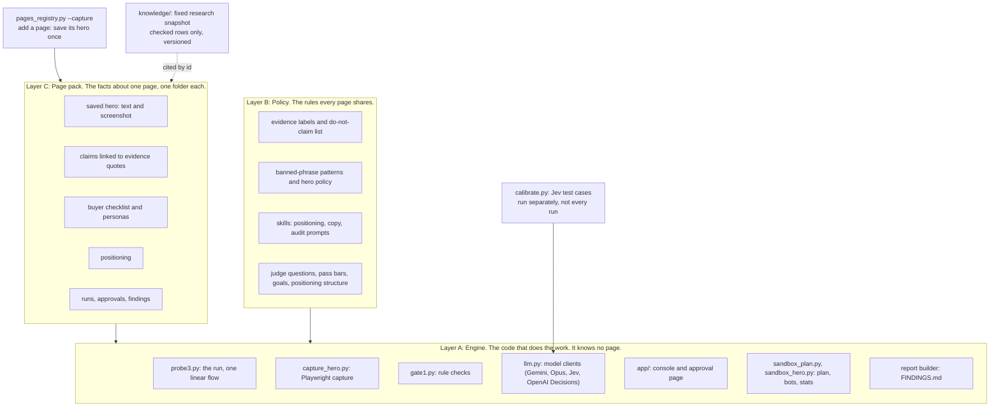
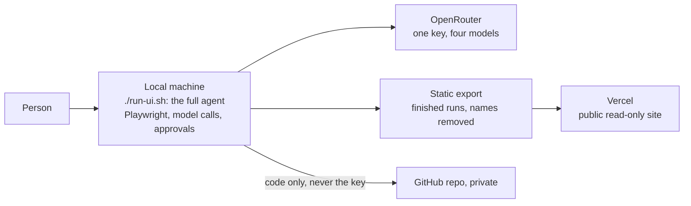

# Sarvam website agent: architecture

v9, 15 Nov 2026, as built (Decisions Log row 41). Written for: the project owner and any reviewer. One document.

## 1. The run: audit first, write only if there is a gap

```mermaid
flowchart TD
    S["1 Start (person)<br/>page, industry, buyer persona, goal<br/>picked from drop-downs in the console"] --> C["2 Capture the page once with Playwright<br/>keep the hero only: H1, sub-line, main CTA text<br/>plus a hero screenshot (desktop)<br/>the rest of the page is stored, never audited"]
    C --> P{"3 Saved positioning<br/>for this page?"}
    P -- yes --> L["Load positioning and approved claims"]
    P -- no --> G["Reasoning model (Gemini) drafts it<br/>with the positioning skills, 12 sections<br/>from the page text and knowledge/ only, labelled PROPOSED"]
    G --> GC["Rules check claim quotes, knowledge ids and numbers"] --> GP["Person approves, once per page"]
    GP --> L
    L --> A["4 AUDIT the hero: JEV only<br/>yes/no questions on the buyer, value, proof, CTA,<br/>positioning, and the buyer's own checklist"]
    A --> D{"Gap found?<br/>a required question fails"}
    D -- no --> N["Stop: report 'no gap'<br/>nothing is written"]
    D -- yes --> H["5 GAP DOSSIER (written out in full)<br/>Gemini writes it, rules check every number and quote<br/>what the hero says now, exact text<br/>which question fails and why it matters to this buyer<br/>hypothesis: if we change X for buyer Y, the click rises, because E<br/>what we do not know: no internal analytics<br/>what would prove it wrong"]
    H --> T["6 TEST PLAN<br/>action: a click on the main CTA, to the real link for the goal<br/>pass bars and rules saved with the run<br/>(a separate hashed plan file is not built yet)"]
    T --> W["7 Writer (Opus) drafts 3 hero variants<br/>each line lists the claim ids it relies on<br/>keeps what the live hero already answers"]
    W --> G1{"Gate 1: RULES<br/>claim id, quote, banned word<br/>only the hero changed<br/>no new number or comparison<br/>CTA goes to a real link for the goal"}
    G1 -- fail --> R{"Rounds left? max 2"}
    R -- yes --> W
    R -- no --> X["Stop: show failures to the person"]
    G1 -- pass --> G2{"Gate 2: DOUBLE CHECK<br/>JEV + JUDGE 2 (OpenAI Decisions)<br/>claim supports the line, no overreach, beats the baseline<br/>disagreement = HOLD; near miss is flagged"}
    G2 -- every variant, with its result --> PX["8 Apply the words to the captured page<br/>text swap only, layout and styles unchanged<br/>screenshot the hero of each arm"]
    PX --> F["Functional check<br/>the CTA of each arm points to the right link"]
    F --> AP{"9 HUMAN approval<br/>PNG side by side: baseline and variant<br/>both judges' scores, the dossier, the claim map<br/>person picks one variant<br/>a Gate 2 failure needs a typed reason"}
    AP -- reject --> RJ["Variant stays inactive<br/>no exposure"]
    AP -- revise --> W
    AP -- approve --> SB["10 Sandbox<br/>simulated visitors: this buyer plus the other roles in the industry<br/>lift set from the judges' scores, visitors from a real-test calculation<br/>Playwright bots click the CTA in each arm on a local copy<br/>3 tests: expected lift, too few visitors, A/A"]
    SB --> FD["11 Findings report built from the data<br/>plain words first, then the set-up<br/>rates, intervals, the sample a real test needs<br/>all SYNTHETIC<br/>status line: NOT rolled out, rollout needs approval"]
    FD --> DOC["12 Submission files<br/>README, architecture note, Jev note,<br/>real versus simulated, limitations"]
```

## 2. The three layers

- **Layer A, Engine:** the code that does the work. It holds no page names, so one engine serves every page.
- **Layer B, Policy:** the rules every page shares. Change a rule once and it applies to all pages.
- **Layer C, Page pack:** the facts about one page, one folder each. A new page is a new folder.

## 3. The questions Jev asks, and why

Jev answers yes/no questions with a probability. It gives no reason. Pass and fail lines come from 60 test cases we wrote (`calibrate.py`).

| Group | Questions | Why we ask them |
|---|---|---|
| 1. The hero basics (required) | A1 audience, A2 value, A3 proof, A4 CTA | Every buyer page must say who it is for, what the buyer gets, why to believe it and what happens on click. A fail or hold here is a gap, and only these four can start a rewrite. |
| 2. Positioning fit (advisory) | A5 positioning, A6 rival swap | A good hero says what this product promises, in words a rival could not print as is. A5 checks the approved promise is there. A6 asks if a rival could reuse the hero unchanged (only when rival heroes are saved). They inform the person but never block. |
| 3. The buyer's own questions (advisory, per page) | A7 checklist items, A8 main objection | Generic questions miss what a specific buyer asks. These come from the approved buyer checklist for this page and buyer, so they change with every page and persona. |
| 4. Checks on each variant (Gate 2) | G1 support, G2 overreach, G3 banned, then A1 to A8 again | Stop the writer from over-claiming. G1 asks if the evidence says what the line says. G2 asks if the line says more. G3 asks if it makes a banned claim in other words. Asking the audit questions again of the variant shows whether it beats the live hero. |

## 4. Deployment

| What | Where it works | Why |
|---|---|---|
| Capture with Playwright and Chromium | Local machine | Vercel functions cannot run a full browser. |
| Model calls (Gemini, Opus, Jev, Judge 2) | Local machine | The key lives in `.env` or the environment. It is never in the repo or the export. |
| Page setup, approvals, Start a run, Run the sandbox | Local console | A person clicks. The console accepts only requests from its own page. |
| Reading runs, audits, variants, scores, findings, docs | Local console or the Vercel read-only copy | The copy is static files. Approver names become "a person". |
| Live runs for other people | Their own machine, using the README | A hosted version would need a container host for the browser and a key per user. Not built. |

## 5. What it uses

| Role | Model id | Endpoint | Returns | Used in |
|---|---|---|---|---|
| Reasoning LLM | google/gemini-3.8-flash | OpenRouter chat completions | Text: page-setup research and claim drafts, positioning draft, dossier prose, submission prose. Never decides pass or fail. | Page setup, steps 3, 5, 12 |
| Writer LLM | anthropic/claude-opus-5.5 | OpenRouter chat completions | Text: hero variants (H1, sub-line, button) and their claim map | Step 7 |
| Jev (Judge 1) | typesafe/jev-1.14 | OpenRouter Decisions API | Probabilities only. No text. | Steps 4, 8, calibration |
| Judge 2 | openai/gpt-6-luna-decisions | OpenRouter Decisions API | Probabilities only. No text. | Step 8, calibration |

- **Four makers, one key.** Google's Gemini reasons, Anthropic's Opus writes, TypeSafe's Jev and OpenAI's decision model judge. No judge grades its own maker's writing.
- **Models never decide a fact.** Code checks every quote, number, id and banned phrase. A person approves. Judges return probabilities, not reasons.
- **Cost.** A run costs about $0.25 to $0.50. A sandbox costs a cent or two. The reasoning model drafts page setup for about $0.05 to $0.10.
- **Swap a model** in `agent/models.json`, or with `MODEL_REASONING`, `MODEL_WRITER`, `MODEL_JUDGE1`, `MODEL_JUDGE2`. The decisions endpoint accepts only Jev and the OpenAI decision model today.

| Tool | Used for |
|---|---|
| Python 3.9 or newer, standard library | The console server, rules, statistics, the run. No framework. |
| Playwright with Chromium | Capture of the hero, the PNG pairs, and the 20 scripted sessions per arm in the sandbox. |
| OpenRouter | One key for chat models and for the decisions endpoint. Every call is logged with its cost. A cap of $1.00 per process stops overspend. |
| Mermaid (in the browser) | Draws the diagrams in this document only. It is not used at runtime. |
| Semrush (one-off read) | Search visits for the page list. A column only: about 96% of sarvam.ai search visits in India go to free translation tools. |
| Claude Code | Built the project. It is not part of the running agent. |

| Rule file | Holds |
|---|---|
| rules/do-not-claim.md | Banned and unproven claims. Gate 1 and the judges both use it. |
| rules/hero-policy.json | Stretch phrases, keep rules, per-page qualifiers (a price must keep the word 'from'). |
| rules/goals.json | Five goals, the real link kind behind each, the goal wording and suggested goal for each buyer role. |
| rules/judge-questions.json | Every audit and Gate 2 question, and the better-than-baseline rule (gain 0.10, drop 0.05). |
| rules/judge-thresholds.json | Pass and fail lines per question, set by calibration against 60 cases. |
| rules/positioning-structure.json | The 12 sections every positioning pack must follow, with the label rules. |
| agent/sandbox_hero.json | The typed assumptions of the sandbox: base click rate, lift rule, goal-fit values, caps. |

## 6. Limits

- The sandbox is synthetic. The lift is set from the judges' scores by a rule, so the simulation cannot show that a variant wins. It shows how many real visitors a real test needs.
- The base click rate (4%) and the goal-fit values are typed assumptions, labelled in every findings file.
- Jev and Judge 2 are general decision models, not trained for this work. Their pass lines come from a small case set we wrote. Scores are an audit signal, not proof.
- Buyer personas and goal suggestions are analyst proposals, not buyer research.
- The hero only, on desktop. No page body, no mobile view.
- A person makes every approval. The agent never writes an approval by itself, except where the owner told it to and the record says so.
